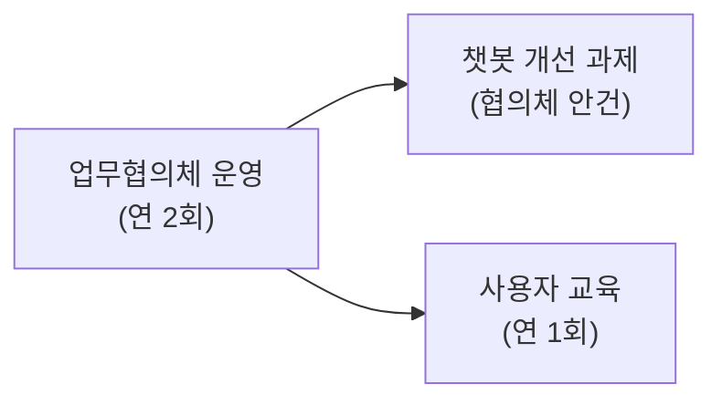

# 문서 작성 가이드

이 프로젝트의 문서 품질과 일관성을 유지하기 위한 작성 가이드라인입니다. 인수인계 자료를 무엇을 어떻게 재구성하고 보존하는지는 `.agents/skills/handover-to-mkdocs/SKILL.md`에, 질문지를 만들고 답변을 반영하는 판단 규칙은 `.agents/skills/handover-questionnaire/SKILL.md`에 있고, 이 가이드는 그 결과 문서의 **형식**(골격, 문법, 등록, 검증)을 정합니다.
`mkdocs/docs/` 아래의 마크다운(`.md`) 파일을 작성·수정할 때 적용합니다. `AGENTS.md`, `SKILL.md`, 스크립트, 내부 계획 파일, 생성물은 제외합니다. 홈(`index.md`) 자체의 수정은 최근 업데이트 항목으로 등록하지 않습니다.

---

## 1. 기본 원칙 및 문체 (Anti-AI Slop)

1. **3초 법칙 & 명확한 요약**:
   - 읽는 사람이 3초 안에 "이 문서가 내가 찾던 것인가"를 판단할 수 있어야 합니다.
   - 문서 시작부에 **한 문장 요약**과 **결론/요약** 섹션을 우선 배치합니다.
2. **문서 작성일 최상단 단일 기입 (요약 표 중복 금지)**:
   - 사용자가 별도로 요청하지 않더라도 적용 대상 콘텐츠 문서 최상단 H1 바로 아래에 최초 작성일(`- **작성일**: YYYY-MM-DD`)을 반드시 기입합니다.
   - 작성일은 최초 작성일로 보존합니다. 실질적인 내용 변경이 있을 때 그 아래에 `- **최종 수정일**: YYYY-MM-DD`를 갱신합니다.
   - 기존 문서가 `최종 검토일` 등 다른 라벨을 이미 사용하고 있다면, 사용자가 통일을 요청하기 전까지 그 라벨을 그대로 유지하고 날짜만 갱신합니다. 라벨 뒤 괄호에 변경 사유를 병기하는 기존 관례가 있으면 함께 유지합니다.
   - 최상단 H1 아래에 작성일이 명시되므로, 하위의 `## 요약` 표 내부에는 작성일을 절대 중복 기입하지 않습니다.
3. **구체적이고 사실적인 서술**:
   - 미사여구나 과장된 표현("혁신적인", "완벽한", "not just X — it's Y" 등 AI 전형적인 수식어)을 배제합니다.
   - "간단히", "쉽게" 같은 주관적 단어를 피하고, 실제 수행 단계와 값을 명시합니다.
4. **독립적인 문서 구성**:
   - 검색을 통해 특정 섹션으로 바로 유입되는 독자를 위해 "위에서 설명했듯이", "앞서 언급한 바와 같이" 등의 의존적 표현을 쓰지 않습니다.
   - 담당자 이름만 적지 않고, 조직 내 **역할과 절차**를 명시합니다 (담당자는 변경될 수 있음).
5. **절제된 시각 요소 및 텍스트 우선**:
   - 이모지(Emoji) 남발을 금지하며, 알림 상자(Admonition)나 뱃지는 강조가 반드시 필요한 곳에만 목적에 맞게 사용합니다.
   - UI 변경 시 쉽게 낡고 검색되지 않는 이미지/스크린샷보다 **텍스트 설명을 우선**합니다. 이미지가 필요한 경우 설명을 반드시 병기합니다.
   - Mermaid와 Vega-Lite는 독자의 이해를 실질적으로 돕는 곳에 사용하고, 문서를 꾸미기 위한 용도로는 쓰지 않습니다. 사용 기준은 5.4절의 "시각화 도구 사용 기준"을 따릅니다.
6. **부가 설명 및 질의응답 추가 시 알림 상자(`!!! note`) 적극 활용**:
   - 기존 본문 내용을 수정하는 것이 아니라, 특정 개념의 원리·배경·심층 질문에 대한 **부가적인 설명이나 FAQ성 내용을 추가할 때는 본문 줄글에 억지로 끼워 넣지 않고 독립된 알림 상자(Admonition)**로 분리하여 배치합니다. 이를 통해 본문의 명쾌한 개요 흐름을 해치지 않고 심층 지식을 효과적으로 전달합니다.
   - 인수인계 건별 문서에 인계자의 질문지 답변을 반영하는 경우는 예외입니다. 답변은 본문의 빈 부분을 채우는 내용이므로 4.3절에 따라 본문에 녹여 넣습니다.

---

## 2. 레이아웃 & 시각화 절대 금지 규칙 (중요)

### 2.1 텍스트/ASCII 박스 드로잉(`┌───┐`, `│`) 절대 사용 금지
코드 블록 안에 `┌───┐`, `└───┘`, `│` 같은 ASCII/유니코드 박스 기호로 표나 네모 박스를 그리는 행위는 **절대 금지**합니다.
- **금지 이유**: 한글(전각 2바이트)과 영문/특수기호(반각 1바이트)의 폰트 글리프 너비 비율이 화면/폰트 렌더링에 따라 불일치하여 **가로 줄 맞춤이 완전히 깨지고 레이아웃이 흉하게 왜곡**됩니다.
- **올바른 대안**:
  1. **항목 비교 / 데이터 나열**: 표준 **마크다운 표(`| 표 |`)** 사용
  2. **흐름도 / 연결 구조 / 아키텍처**: **Mermaid 다이어그램(` ```mermaid `)** 사용
  3. **정량적 수치 추이 / 통계 분포**: **Vega-Lite 차트(` ```vegalite `)** 사용
  4. **내용 묶음 / 강조**: **알림 상자(`!!! note`, `!!! tip`)** 또는 **콘텐츠 탭(`===`)** 사용

### 2.2 사용자 원문 입력 시 다중 H1(`#`) 정규화 필수
사용자가 프롬프트에 `# 1. ...`, `# 2. ...` 등 H1을 여러 개 포함하여 제공하더라도, 마크다운 문서로 변환할 때는 **문서 최상단 단일 H1(`#`)만 유지**하고 본문 섹션은 반드시 `##` (H2), `###` (H3)으로 변환해야 합니다.
- MkDocs의 우측 목차(TOC)와 네비게이션은 `##`과 `###`을 기준으로 생성되므로 본문에 H1이 남발되면 사이트 네비게이션이 파괴됩니다.

### 2.3 `docs/index.md` Frontmatter `title` 선언 금지
- 루트 홈 문서(`mkdocs/docs/index.md`)에 `title: kwonsu의 업무노트` 같은 frontmatter를 넣지 않습니다.
- Material 테마가 `<title>{문서제목} - {사이트명}</title>` 형태로 자동 조합하므로, 홈 문서에 `title`이 있으면 브라우저 탭에 `kwonsu의 업무노트 - kwonsu의 업무노트`처럼 이름이 중복 노출됩니다.

### 2.4 숫자 리스트(Ordered List) 내 하위 불릿 혼용 금지 (파서 오류 방지)
- **문제 원인**: Python-Markdown 파서 특성상 `1.`, `2.`, `3.` 하위에 하위 불릿(`-`)을 넣을 때 들여쓰기 공백이 4칸 미만이면, 파서가 하위 항목까지 단일 `<ol>`로 해석하여 `1., 2., 3., 4., 5., 6.`으로 모든 항목에 번호를 매기는 심각한 렌더링 왜곡이 발생합니다.
- **작성 규칙**:
  - 하위 설명이나 세부 불릿이 포함되는 구조에서는 `1.`, `2.` 숫자 리스트를 쓰지 말고 **불릿 리스트(`- **① ...**`)** 또는 **소제목(`####`) / 표 / 카드**를 사용해야 합니다.
  - 올바른 예:
    ```markdown
    - **① 첫 번째 핵심 포인트**:
        - 세부 내용 설명
    - **② 두 번째 핵심 포인트**:
        - 세부 내용 설명
    ```

### 2.5 중첩 리스트(Nested List)는 반드시 공백 4칸(4 spaces) 들여쓰기
- **문제 원인**: Python-Markdown 파서는 공백 2칸(`  - `) 들여쓰기를 하위 레벨 리스트로 인식하지 못하고 상위 불릿과 동일한 레벨(평면 렌더링)로 취급하여 **들여쓰기가 완전히 깨지는 현상**이 발생합니다.
- **작성 규칙**:
  - 마크다운 리스트 내 하위 불릿을 작성할 때는 **반드시 4칸의 공백(`    - `)**을 들여써야 합니다.
  - 올바른 예:
    ```markdown
    - **상위 항목**:
        - 하위 설명 항목 (공백 4칸)
    ```

### 2.6 문서 결론부(Conclusion)의 독립성 및 완성도 보장 (중요)
- **오류 현상**: 이전 하위 소제목(예: `### 세부 항목`) 바로 아래에 `!!! tip "최종 결론"` 형태의 콜아웃 박스만 배치하면, 문서 전체의 핵심 결론이 상위 섹션이 아니라 직전 하위 소제목에 딸린 부속 설명 박스로 오인되는 심각한 구조적 왜곡이 발생합니다.
- **작성 규칙**:
  - 최종 결론은 구분선(`---`) 뒤의 독립된 `##` 또는 `###` 섹션으로 작성합니다. 번호와 제목은 문서 구조에 맞춥니다. 아래 제목은 예시이며 고정 문자열이 아닙니다. 결론에는 종합 인사이트, 시나리오/로드맵, 실행 원칙 등 내용에 맞는 구조화된 내용을 포함합니다.
  - 인수인계 개요 문서(4.2.1절)는 마지막 독립 섹션을 `인수인계 확인 사항`으로 둡니다. 하위 문서(4.2.2절)에는 이 섹션을 두지 않습니다. 원문에 근거해 후임자가 챙겨야 할 일정·미결 사항과 변환 과정의 변경 사항을 적습니다.

### 2.7 미지원 LaTeX 수식 문법(`$$`, `\frac`) 사용 금지 (HTML 수식 컴포넌트 사용)
- **금지 이유**: 사이트에 무거운 MathJax/KaTeX JS 라이브러리를 로드하지 않는 디자인 정책상, `$$ \text{...} = \frac{A}{B} $$` 같은 LaTeX 수식을 작성하면 수식이 렌더링되지 않고 raw 텍스트(`$$ \text{...} $$`)가 그대로 화면에 노출되는 치명적인 결함이 발생합니다.
- **올바른 대안**:
  1. 분수나 수식 관계 표현 시 **반응형 HTML Flex 수식 컴포넌트**(`display: inline-flex`, 분자 `border-bottom: 1.5px solid`, 디자인 시스템 CSS 변수 활용) 사용
  2. 예시:
     ```html
     <div style="display: flex; align-items: center; justify-content: center; margin: 1.2rem 0; padding: 1.1rem; background: var(--md-code-bg-color); border: 1px solid var(--kb-border); border-radius: var(--kb-radius-md);">
       <span style="font-weight: 600; color: var(--kb-text-strong);">기업 가치</span> &nbsp;=&nbsp;
       <span style="display: inline-flex; flex-direction: column; vertical-align: middle; text-align: center;">
         <span style="border-bottom: 1.5px solid var(--kb-text-strong); padding: 0 0.5rem 0.2rem; font-weight: 600;">분자</span>
         <span style="padding-top: 0.2rem; font-size: 0.85em; color: var(--kb-text-muted);">분모</span>
       </span>
     </div>
     ```
  3. 변수 관계는 마크다운 표나 Mermaid 다이어그램으로 시각화

### 2.8 강조 표기 시 특수문자('★') 남발 금지 및 형광펜('<mark>텍스트</mark>') 사용 원칙
- **금지 이유**: 본문이나 표, 소제목에 별표(`★`), 이모지 등 특수문자를 남발하면 문서가 조잡해 보이고(Anti-AI Slop 위반), Mermaid 다이어그램 등 파서 환경에서 문법 오류를 유발할 수 있습니다.
- **올바른 대안**:
  - 중요한 기관, 핵심 키워드, 추천 항목을 강조할 때는 **형광펜 하이라이트(`<mark>강조할 텍스트</mark>`)**를 사용합니다.
  - Python-Markdown 파서 특성상 볼드(`**`)나 괄호 `()` 등이 중첩될 때 마크다운 `==텍스트==` 문법이 파싱되지 않고 그대로 노출되는 버그를 원천 방지하기 위해 **HTML 표준 태그인 `<mark>...</mark>` (또는 `<mark>**볼드 텍스트**</mark>`) 사용을 권장**합니다.

### 2.9 이미지와 설명 텍스트 간 개행(빈 줄) 필수 (한 줄 붙음 방지)
- **금지 이유**: 마크다운에서 `` 바로 다음 줄에 빈 줄(Blank line) 없이 `- **화면 설명**: ...` 또는 일반 텍스트를 연달아 작성하면, Python-Markdown 파서가 이미지를 인라인(Inline) 요소로 취급하여 단일 단락(`<p>`) 태그 내부에 함께 묶어버립니다. 그 결과 브라우저 렌더링 시 **이미지 바로 우측에 설명 텍스트가 한 줄로 나란히 이어 붙어 레이아웃이 흉하게 왜곡**되는 심각한 결함이 발생합니다.
- **올바른 대안**:
  - `` 위아래에는 **반드시 1줄 이상의 빈 줄(Blank line)**을 두어 이미지가 독립된 블록 단락(`<p></p>`)으로 분리되도록 해야 합니다.
  - 여러 장의 이미지를 연속으로 배치할 때도 이미지 태그 사이에 빈 줄을 두고, 하단 설명 리스트(`- **화면 설명**:`) 직전에도 반드시 빈 줄을 삽입합니다.
  - 올바른 예:
    ```markdown
    ##### ① 결재정보 화면

    

    - **화면 설명**: K-에듀파인 결재정보 화면의 세부 설명...
    ```

### 2.10 날짜·번호로 시작하는 줄은 순서 목록으로 바뀐다 (`10. 12.` → `1. 12.`)
- **문제 원인**: Python-Markdown은 줄의 첫머리나 목록 항목의 첫머리가 "숫자 + 마침표 + 공백"이면 순서 목록으로 해석하고, 번호를 1부터 다시 매깁니다. 공문서의 날짜 표기가 이 형태이므로 `- 10. 12.(월) ~ 10. 30.(금): 설문`은 화면에 `1. 12.(월) ~ 10. 30.(금): 설문`으로 표시되어 날짜의 월이 사라집니다. 원문의 번호 문단(`2. 개선 요구사항`)도 `1.`로 바뀝니다. 빌드 경고가 나오지 않으므로 화면을 보지 않으면 알 수 없습니다.
- **작성 규칙**:
  - **날짜가 둘 이상 나열되는 내용(일정, 기한, 경과)은 목록이 아니라 표로 씁니다.** 표의 칸 안에서는 이 해석이 일어나지 않습니다.
  - 목록이나 문단을 날짜로 시작해야 한다면 `**10. 12.(월)**: 설문 시작`처럼 굵은 글씨로 감싸거나, 날짜 앞에 낱말을 둡니다(`기한 10. 12.(월)`). 연도부터 써도 `2026. 10. 12.`가 `2026.`으로 시작하므로 같은 문제가 생깁니다.
  - 원문의 번호를 그대로 보여야 하는 문단은 `2\. 개선 요구사항`처럼 마침표를 이스케이프합니다.
  - 잘못된 예와 올바른 예:
    ```markdown
    - 10. 12.(월) ~ 10. 30.(금): 만족도 설문        ← 화면에 "1. 12.(월) ~ …"로 표시됨

    | 기한 | 할 일 |
    | :--- | :--- |
    | 2026. 10. 12.(월) ~ 10. 30.(금) | 만족도 설문 |
    ```
- **점검 방법**: 순서 목록을 의도해서 쓰지 않은 문서라면, 빌드한 HTML의 본문에 `<ol>`이 하나도 없어야 합니다. `<ol>`이 있으면 그 첫 항목을 원문과 대조합니다.

### 2.11 분기 표기(`1/4`, `3/4`)는 분수 기호로 바뀐다
- **문제 원인**: 사이트가 쓰는 `pymdownx.smartsymbols` 확장은 `1/4`, `1/2`, `3/4` 같은 분수 표기를 분수 기호 `¼`, `½`, `¾`로 바꿉니다. 공문서의 분기 표기 `3/4분기`가 화면에 `¾분기`로 표시되고, 검색에서도 찾을 수 없게 됩니다. `2/4`는 바뀌지 않아 한 표 안에서 표기가 들쭉날쭉해집니다.
- **작성 규칙**: 분기는 `1&#47;4분기`, `3&#47;4분기`처럼 빗금을 HTML 문자 참조로 적습니다. 일관성을 위해 `2&#47;4분기`, `4&#47;4분기`도 같은 방식으로 적습니다. 코드 블록 안에서는 바뀌지 않으므로 그대로 둡니다.

---

## 3. 파일 및 디렉터리 규칙

### 3.1 파일명 규칙
- **영문 소문자**, **숫자**, **하이픈(`-`)**만 사용합니다 (URL 일관성 및 인코딩 깨짐 방지). 폴더명과 이미지 파일명도 같습니다.
    - 올바른 예: `incident-response.md`, `annual-plan-2025.md`, `budget/`
    - 잘못된 예: `배포절차.md`, `incident_response.md`, `Onboarding.md`, `image 1.png`
- 한글 제목은 파일명이 아니라 `mkdocs/mkdocs.yml`의 `nav`에서 지정합니다.

### 3.2 디렉터리 배치
- `mkdocs/docs/handover/`: 인수인계 자료를 재구성한 문서 아카이브. 마스터 허브(`handover/index.md`)와 건별 폴더(`handover/<건별-슬러그>/`)로 구성됩니다. 건별 폴더에는 개요 문서 `index.md`와 업무별 하위 문서 `<주제>.md`를 평탄하게 두고 (예: `handover/2024-hong-gildong/index.md`, `handover/2024-hong-gildong/council.md`), 그 건의 이미지는 개요 문서와 하위 문서가 함께 쓰는 `handover/<건별-슬러그>/images/`에 둡니다.
- `mkdocs/docs/work/`: 인수한 업무를 이어서 수행하며 직접 작성하는 업무 문서(업무 계획, 준비 사항). 업무와 연도별 폴더(`work/council-2027/`)에 두고, `nav`에서는 `업무관리` 탭 아래에 `27년 업무협의체`처럼 연도와 업무 이름의 섹션으로 묶습니다. 인수인계 자료에 근거한 사실에는 인수인계 문서와 같이 출처를 적고, 자료에 없는 제안은 제안임을 밝힙니다.
- 위 목록에 해당하지 않는 새로운 유형의 문서는 가장 가까운 디렉터리를 선택하거나 새 디렉터리를 만들어 배치하고, 선택한 근거를 답변에 한 줄로 남깁니다. 배치 위치를 이유로 작업을 중단하지 않습니다.
- 이미지 파일:
    - 개별 문서 전용 이미지는 문서와 같은 폴더의 `images/<문서 파일명>/` 아래에 배치: `` (인수인계 건별 문서는 건 폴더의 모든 문서가 `images/` 바로 아래를 함께 사용)
    - 전역 공용 이미지는 `mkdocs/docs/assets/`에 배치

### 3.3 `mkdocs.yml` 메뉴(`nav`) 등록
문서를 생성한 후에는 반드시 `mkdocs/mkdocs.yml`의 `nav` 설정에 추가해야 사이트 메뉴에 노출됩니다. `nav`에 빠진 문서가 있으면 `mkdocs.yml`의 `validation` 설정 때문에 빌드 검증(6절)이 실패합니다.
- `nav` 구조는 폴더 구조와 같게 둡니다. 한 섹션에 문서가 15개를 넘거나 시계열 분류가 필요하면 하위 섹션(하위 분류, 연도 등)으로 묶어 들여씁니다.
- 인수인계 문서는 건마다 `YYYY년 <담당자명>` 섹션을 두고 첫 항목에 개요 문서, 그 아래에 하위 문서를 둡니다. 예시는 `handover-to-mkdocs` 4.5절에 있습니다.

### 3.4 홈 화면(`mkdocs/docs/index.md`) 자동 갱신 (필수)
적용 대상 콘텐츠 문서를 추가하거나 실질적으로 수정할 때마다, 독자가 첫 화면에서 최근에 바뀐 문서를 바로 찾을 수 있도록 홈 랜딩 페이지(`mkdocs/docs/index.md`)의 **`## 1. 최근 업데이트 (Recent Updates)`** 표의 해당 문서 항목을 반드시 한 번 갱신합니다. 기존 항목은 수정하며 중복 행을 추가하지 않습니다. 홈 자체의 수정은 등록하지 않습니다.
- **갱신 대상 한정**:
    - 홈 갱신 대상은 문서의 실질적인 내용이 달라지는 변경(신규 작성, 섹션 추가·삭제, 결론·수치·판단의 변경)으로 한정합니다.
    - 오탈자 교정, 서식·들여쓰기 정리, 링크 경로 보정만 수행한 경우에는 최종 수정일과 홈 표를 갱신하지 않습니다.
- **업데이트 표 규칙**:
    - 열 구성은 `index.md`에 이미 존재하는 표의 헤더를 그대로 따릅니다(현재: `분류`, `문서 제목`, `대상 / 분야`, `작성일`, `바로가기`). 헤더 자체는 사용자가 요청한 경우에만 변경합니다.
    - 날짜 열에는 최종 수정일이 있으면 그 날짜를, 없으면 최초 작성일을 기입하고, 이 날짜를 기준으로 **내림차순 정렬**합니다.
    - `바로가기`는 `[문서 열기](상대경로)` 형식으로 기입합니다.
    - 신규 대분류 카테고리가 생성된 경우, `index.md` 최상단의 `## 요약` 표에도 해당 카테고리 항목을 추가합니다. 열 구성은 이미 존재하는 헤더를 따릅니다(현재: `대분류`, `주요 다룸 분야`, `탐색 가이드`, `바로가기`).
- **인수인계 문서**:
    - 홈 최상단 `## 요약` 표에는 `인수인계 자료` 대분류 1행을 두고 마스터 허브(`handover/index.md`)로 연결합니다.
    - `## 1. 최근 업데이트` 표에는 하위 문서가 여러 개여도 **인수인계 건마다 1행**만 두고, 그 건의 개요 문서나 하위 문서 가운데 하나라도 등록되거나 실질적으로 바뀔 때 갱신합니다.
    - `분류`에는 `인수인계`, `문서 제목`에는 `[YYYY년] <담당자명> 인수인계 자료 (원본 N건)`, `바로가기`에는 `[문서 열기](handover/<건별-슬러그>/index.md)`를 적습니다.
    - 날짜는 그 건의 문서들 가운데 가장 늦은 최종 수정일(없으면 개요 문서의 작성일)입니다. 원본 추가·변경의 반영과 질문지 답변의 반영은 실질적인 변경이고, 질문지를 만들면서 `인계자 확인 요청`과 `질문지 현황`만 기록한 것은 실질적인 변경이 아닙니다.

---

## 4. 표준 문서 골격

### 4.1 직접 작성 문서 골격 (분석·정리형)

```markdown
# 문서 제목

- **작성일**: YYYY-MM-DD

문서의 목적과 대상을 설명하는 한 문장 요약.

## 요약

| 구분 | 주요 내용 |
| :--- | :--- |
| **핵심 항목 1** | 바쁜 독자가 3초 안에 확인할 수 있는 핵심 결론 |
| **핵심 항목 2** | 주요 수치, 상태 또는 상태값 |

---

## 1. 상세 내용

절차나 본문 설명. 단계별 실행 절차는 번호 목록을 사용합니다:

1. 첫 번째 단계 실행
2. 두 번째 단계 확인
3. 세 번째 단계 검증

---

## 2. 비교 및 분석

| 비교 항목 | A 방안 | B 방안 |
| :--- | :--- | :--- |
| **핵심 특징** | 설명 A | 설명 B |
| **장단점** | 장점 및 한계점 | 장점 및 한계점 |

---

## 3. 종합 평가 및 결론

### 3.1 항목별 세부 평가
세부 평가 내용 및 비교 분석 표.

---

### 3.2 최종 종합 결론 및 실행 제언

문서 전체를 관통하는 핵심 결론, 시나리오별 로드맵, 그리고 구체적 행동 방침을 명시합니다.

| 구분 | 주요 액션 아이템 | 우선순위 | 목표 일정 |
| :--- | :--- | :---: | :--- |
| **단기 실행** | 즉시 확인 및 대응해야 할 작업 | 높음 | 즉시 |
| **중기 점검** | 지표 모니터링 및 단계적 실행 방침 | 보통 | 주간 점검 |

!!! tip "최종 핵심 제언 (Executive Takeaway)"
    문서의 궁극적인 핵심 결론과 실행 원칙을 요약합니다.
```

### 4.2 인수인계 건별 문서 골격

인수인계 자료는 건마다 **개요 문서**(`handover/<건별-슬러그>/index.md`) 하나와, 필요한 경우 업무별 **하위 문서**(`handover/<건별-슬러그>/<주제>.md`)로 작성합니다. 이 절은 골격과 형식만 정합니다. 무엇을 담고 무엇을 출처로 넘기는지(중요 내용 기준표), 언제 하위 문서로 나누는지는 `handover-to-mkdocs` 4.3·4.4절을 따릅니다.

#### 4.2.1 개요 문서 골격

개요 문서는 인수자가 가장 먼저 처음부터 끝까지 읽는 문서입니다. **업무 전체의 흐름을 파악하게 하는 것**이 목적이므로, 세부는 하위 문서로 보내고 이 문서는 약 300~500줄 안에서 끝냅니다.

````markdown
# 2024년 홍길동 업무 인수인계 (소관 업무명)

- **작성일**: YYYY-MM-DD (변환해 등록한 날)

누구의 어떤 업무를 이어받기 위한 문서인지 한 문장으로 설명합니다.

## 요약

| 구분 | 내용 |
| :--- | :--- |
| **인계자 · 부서** | 홍길동 · ○○부 |
| **소관 업무·시스템** | 인수자가 맡게 되는 업무와 사용하는 시스템 |
| **기준 시점** | 자료가 작성된 시점 (예: 2024년 2월) |
| **먼저 할 일** | 인수 직후에 챙겨야 하는 기한·조치 2~3가지 |
| **상세 문서** | [업무협의체 운영](council.md) · [관계자 명단](contacts.md) |
| **원본 자료** | `업무인수인계_홍길동/` · 11건 (변환 10, 미지원 1) |

---

## 1. 업무 한눈에 보기

### 1.1 업무 지도



업무 사이의 관계를 한 장으로 보여 줍니다. 도표에 담지 못한 조건과 단서는 도표 바로 아래에 불릿으로 적습니다.

### 1.2 업무 목록

| 업무 | 하는 일 | 주기·시기 | 관련 부서·시스템 | 상세 |
| :--- | :--- | :--- | :--- | :--- |
| 업무협의체 운영 | 시도교육청 담당자 협의회 개최 | 연 2회(3월, 7월) | 17개 시도교육청 | [업무협의체 운영](council.md) |
| 공통단위과제 종료 | 연말에 종료 대상 과제를 일괄 종료 | 매년 12월 | 기록관리부 · K-에듀파인 | [3.2절](#32-공통단위과제-종료) |

### 1.3 연간 반복 주기

매년 같은 시기에 돌아오는 일입니다. 올해의 실제 날짜는 1.4절에 있습니다.

| 시기 | 업무 | 할 일 | 인수자 몫 | 반복 근거 |
| :--- | :--- | :--- | :--- | :--- |
| 1&#47;4분기 | 업무협의체 운영 | 1차 협의회 개최 지원(안건 수합, 회의자료 작성) | 사전검토 자료 작성, 회의자료 작성 | 2024년 운영 계획의 분기별 일정 · 반복 여부 확인 필요 (질문지 261012 · Q-002) |
| 12월 | 공통단위과제 종료 | 종료 대상 과제를 일괄 종료 | 쿼리 실행, 결과 통보 | 인수인계서 "매년 12월 말 실시" |

### 1.4 올해 진행 현황

기준 시점: 2024년 2월 (인수인계서 작성일)

| 시기 | 업무 | 실제 일정 | 상태 |
| :--- | :--- | :--- | :--- |
| 1월 | 업무협의체 운영 | 운영 계획 안내 공문 접수 (2024. 1. 15.) | 완료 |
| 3월 | 업무협의체 운영 | 제1차 협의회 (2024. 3. 20.) | 예정 |

---

## 2. 먼저 할 일과 일정

| 기한 | 할 일 | 관련 문서 |
| :--- | :--- | :--- |
| 2024. 12. 31.(화) | 가까운 순서로 정리한 마감일 | [3.2절](#32-공통단위과제-종료) |

---

## 3. 업무별 핵심

### 3.1 업무협의체 운영

- **하는 일**: 이 업무가 무엇인지 1~2문장
- **시기·상대**: 언제, 누구와
- **인수자가 할 일**: 다음에 해야 하는 일
- **주의**: 놓치면 문제가 되는 점

자세한 절차와 회차별 기록은 [업무협의체 운영](council.md)에 있습니다.

출처: `회의자료/1차 협의회 결과.hwp`, `회의자료/2차 협의회 결과.hwp`

### 3.2 공통단위과제 종료

하위 문서로 나누지 않은 짧은 업무는 이 자리에 절차까지 씁니다.

1. 첫 번째 단계 (메뉴 경로, 입력값 포함)
2. 두 번째 단계

??? note "원문: 공통단위과제 종료(쿼리).sql"
    ```sql
    -- 실행해야 하는 쿼리 전문
    ```

출처: `별첨자료/공통단위과제 종료 매뉴얼.pptx`, `별첨자료/공통단위과제 종료(쿼리).sql`

---

## 4. 시스템·계정·권한

| 시스템 | 접속 주소 | 계정·권한 | 신청·변경 방법 |
| :--- | :--- | :--- | :--- |

---

## 5. 관련 부서·연락처

자주 연락하는 상대만 적고, 긴 명단은 하위 문서(예: [관계자 명단](contacts.md))로 연결합니다.

| 부서·기관 | 역할 | 담당자 | 연락처 | 협조 내용 |
| :--- | :--- | :--- | :--- | :--- |

---

## 6. 진행 중인 사안

| 사안 | 현재 상태 | 다음 조치 | 기한 | 상세 |
| :--- | :--- | :--- | :--- | :--- |

---

## 7. 원본 파일 대응표

| 원본 경로 | 형식 · 수정일 | 상태 | 반영한 문서·절 |
| :--- | :--- | :--- | :--- |
| `회의자료/1차 협의회 결과.hwp` | HWP · 2024-03-20 | 변환 완료 | [업무협의체 운영](council.md) 3.1 |
| `별첨자료/공통단위과제 종료 매뉴얼.pptx` | PPTX · 2024-01-15 | 변환 완료 | 3.2 |
| `회의자료/참석자 서명부.pdf` | PDF · 2024-03-18 | 변환 완료 | 참고용(문서에 싣지 않음): 1차 협의회 참석자 서명 |
| `별첨자료/구버전.doc` | DOC · 2023-11-02 | 미지원 | `.docx`로 다시 저장한 뒤 재변환 필요 |

---

## 인수인계 확인 사항

### 일정·기한

| 기한 | 할 일 | 관련 문서 |
| :--- | :--- | :--- |
| 매월 | 반복 일정 | [업무협의체 운영](council.md) 2.1 |

### 미결 사항

| 구분 | 내용 | 관련 문서 |
| :--- | :--- | :--- |
| 자료에 없음 | 자료에서 확인할 수 없어 `확인 필요`로 표시한 부분 | |
| 자료 간 불일치 | 자료마다 값이 다른 부분 | |
| 결정 필요 | 진행 중이거나 결정이 필요한 사항 | |

### 인계자 확인 요청

- 질문지 261012 · Q-001 ~ Q-024 (회신 대기)

### 변환 메모

- **옮기지 않은 그림**: 직인, 반복되는 장식용 그림 등
- **변환하지 못한 원본**: 파일과 조치 방법
````

- **장 구성**: 위 골격의 장 가운데 자료에 해당 내용이 없는 장은 만들지 않고, 자료의 성격에 맞는 장(예: 용어, 예산 현황, 관계 기관과 역할)을 추가합니다. `## 요약`, `1. 업무 한눈에 보기`, `원본 파일 대응표`, `인수인계 확인 사항`은 반드시 둡니다. `1. 업무 한눈에 보기`에는 업무 전체의 흐름을 보여 주는 도표를 하나 이상 둡니다.
- **연간 반복 주기와 올해 진행 현황**: 연간 흐름은 두 표로 나누며, 무엇을 반복으로 적고 상태를 어떻게 정하는지는 `handover-to-mkdocs` 4.2.1절을 따릅니다. 반복 업무가 없는 건은 `올해 진행 현황`만 둡니다. `반복 근거` 칸은 비워 두지 않습니다. 두 표 모두 날짜가 많으므로 목록으로 바꾸지 않습니다(2.10절). 분기는 `1&#47;4분기`처럼 적습니다(2.11절).
- **업무별 핵심**: 하위 문서로 나눈 업무는 `하는 일`, `시기·상대`, `인수자가 할 일`, `주의`를 5~15줄 정도로 적고 하위 문서로 링크합니다. 하위 문서의 내용을 개요 문서에 길게 되풀이하지 않습니다.
- **요약 표의 `상세 문서` 행**: 하위 문서가 있으면 읽는 순서대로 링크를 나열합니다. 하위 문서가 없으면 이 행을 두지 않습니다.
- **끝부분의 순서**: 번호를 붙인 마지막 장인 `원본 파일 대응표` 뒤에는 번호 없는 섹션을 `인계자 보충 답변`(4단계에서 추가) → `질문지 현황`(3단계에서 추가) → `인수인계 확인 사항`의 순서로 둡니다. 이 섹션들과 원본 파일 대응표는 개요 문서에만 둡니다.
- **인수인계 확인 사항의 서식**: `일정·기한`, `미결 사항`, `인계자 확인 요청`, `변환 메모`를 `###` 소제목으로 나눕니다. 일정·기한과 미결 사항은 표로 쓰고(날짜로 시작하는 목록 항목은 2.10절의 문제로 번호가 바뀜), 하위 문서에 있는 항목은 `관련 문서` 칸에 그 문서와 절을 링크합니다. 변환 메모는 항목마다 굵은 라벨로 시작하는 목록으로 씁니다. 해당 내용이 없는 소제목은 만들지 않습니다.
- **인계자 확인 요청**: 질문지를 만든 뒤에 적는 소제목입니다(`handover-questionnaire` 2.5절).

#### 4.2.2 하위 문서 골격

하위 문서는 한 업무를 실제로 수행하거나 자세히 찾아볼 때 읽는 문서입니다. 약 600줄을 넘으면 업무 단위로 다시 나눌 수 있는지 검토합니다.

````markdown
# 업무협의체 운영

- **작성일**: YYYY-MM-DD

17개 시도교육청 업무관리 담당자가 모이는 협의체를 연 2회 운영하는 업무입니다. 전체 업무의 흐름은 [2024년 홍길동 인수인계 개요](index.md)에 있습니다.

## 요약

| 구분 | 내용 |
| :--- | :--- |
| **하는 일** | 협의회 개최, 안건 취합, 결과 공유 |
| **시기** | 연 2회 (3월, 7월) |
| **관련 기관** | 17개 시도교육청 업무관리 담당자 |
| **인수자가 할 일** | 다음 협의회 준비에 필요한 일 |

---

## 1. 운영 체계

## 2. 개최 절차

- **시작 신호**: 교육부의 운영 계획 안내 공문 접수(매년 1월)


### 2.1 단계별로 하는 일

| 단계 | 하는 일 | 담당 | 산출물·전례 자료 | 제1차 | 제2차 |
| :--- | :--- | :--- | :--- | :--- | :--- |
| 1. 계획 수립 | 개최 계획을 세워 결재를 받습니다. | **인수자** 작성 | 협의회 계획 · `회의자료/1차/협의회 계획.hwp` | 2024. 2. 5. | 2024. 6. 3. |
| 2. 개최 안내 | 시도교육청에 개최를 안내합니다. | 주관교육청 시행, 인수자는 공문 접수 | 개최 안내 공문 · `회의자료/1차/개최 안내.pdf` | 2024. 2. 10. | 2024. 6. 12. |

- **준비 기간**: 계획 결재는 개최 4주 전까지(원문). 개최 안내의 시점은 확인 필요 (질문지 261012 · Q-010)

출처: `회의자료/협의회 운영계획.hwp`

### 2.2 전례 자료

다음 회차를 준비할 때 고쳐 쓸 직전 회차의 자료입니다.

| 단계 | 자료 | 원본 경로 |
| :--- | :--- | :--- |
| 계획 수립 | 제2차 협의회 계획 | `회의자료/2차/협의회 계획.hwp` |

## 3. 회차별 기록

### 3.1 2024년 제1차 협의회 (3월 20일)

| 안건 | 결정 사항 | 후속 조치 | 담당 |
| :--- | :--- | :--- | :--- |

발언별 기록은 원본에 있습니다. 출처: `회의자료/1차 협의회 결과.hwp`
````

- **제목과 첫머리**: H1은 업무 이름으로 짓습니다(건 이름을 반복하지 않습니다). 첫 문단에 이 문서가 다루는 업무를 한 문장으로 설명하고 개요 문서로 돌아가는 링크를 둡니다.
- **요약 표**: `하는 일`, `시기`, `관련 기관`, `인수자가 할 일` 가운데 해당하는 행을 둡니다. 작성일은 H1 아래에만 적습니다.
- **본문**: 장 구성은 업무의 성격에 맞게 정합니다(운영 체계, 절차, 회차별 기록, 판단 기준과 예외, 참고 자료 등). 회의·협의의 기록은 결정 사항과 후속 조치를 표로 정리하고, 발언 기록 같은 세부는 출처로 넘깁니다.
- **반복 업무의 절차**: 시작 신호, 흐름도, 단계별 표(단계, 하는 일, 담당, 산출물·전례 자료, 회차별 실제 날짜), 준비 기간, 전례 자료 목록을 둡니다. 담당 칸에서 인수자가 직접 하는 단계는 `**인수자**`로 시작합니다. 회차가 많아 열이 넘치면 회차별 날짜를 별도의 표로 뺍니다. 준비 기간은 원문의 값만 적고 날짜로 계산하지 않습니다(`handover-to-mkdocs` 4.2.1절).
- **두지 않는 섹션**: 원본 파일 대응표, 질문지 현황, 인계자 보충 답변, 인수인계 확인 사항은 하위 문서에 두지 않고 개요 문서에 모읍니다. 하위 문서의 `확인 필요`는 개요 문서의 `미결 사항`에 등록합니다.

#### 4.2.3 개요 문서와 하위 문서 공통

- **제목**: 우측 목차(TOC)로 찾아갈 수 있도록 `##`과 `###` 제목을 업무 이름으로 분명하게 짓습니다.
- **문서 사이의 링크**: 같은 건 폴더 안의 문서는 파일명으로 링크합니다(`[업무협의체 운영](council.md)`, 특정 절은 `council.md#21-단계별로-하는-일`). 앵커가 틀리면 빌드 검증에서 경고가 나오므로 링크한 절의 제목을 확인합니다.
- **접이식 블록**: 그대로 실행할 SQL·스크립트, 문구가 중요한 공문처럼 전문이 꼭 필요한 자료만 `??? note "원문: 파일명"` 형식으로 넣고, 블록 안의 내용은 4칸 들여씁니다. 병합 칸이 있는 HTML 표를 넣어야 하면 `<details class="note" markdown="1">`을 씁니다. 블록 안의 내용도 본문과 같은 기준으로 읽기 좋게 정리하며(제목 상자, 빈 칸뿐인 표, 사라진 글머리표 위계의 처리는 `handover-to-mkdocs` 4.3.1절), 변환 결과를 그대로 붙여 넣지 않습니다.
- **출처**: `###` 단위의 절 끝에 `출처:`로 시작하는 한 줄을 두고, 원본의 경로(건 폴더 기준 상대 경로)를 백틱으로 감싸 적습니다. 세부를 문서에 싣지 않은 절은 원본에서 찾을 수 있도록 위치(쪽, 시트, 슬라이드)까지 적습니다.
- **빈 부분**: 자료에서 확인할 수 없는 칸에는 `확인 필요`라고 적습니다. 질문지에 넣은 뒤에는 `확인 필요 (질문지 YYMMDD · Q-NNN)`으로 질문 번호를 덧붙입니다.
- **날짜**: 작성일과 최종 수정일은 문서마다 따로 관리합니다. 하위 문서만 고쳤다면 그 하위 문서의 최종 수정일만 갱신합니다.

### 4.3 질문지 답변 보강 (인수인계 건별 문서)

인계자가 질문지에 적어 회신한 답변은 그 내용이 속한 문서(개요 문서나 하위 문서)의 해당 절에 녹여 넣고, 질문과 답변의 원문은 개요 문서의 `## 인계자 보충 답변` 섹션에 그대로 남깁니다. 이 절은 그 형식만 정하며, 어떤 답변을 어디에 어떻게 반영하는지는 `handover-questionnaire` 3절을 따릅니다.

```markdown
# 2024년 홍길동 업무 인수인계 (소관 업무명)

- **작성일**: 2026-10-12
- **최종 수정일**: 2026-10-20 (질문지 답변 반영)

## 요약

| 구분 | 내용 |
| :--- | :--- |
| **질문지 반영** | `261012 홍길동 업무인계인수 질문지.xlsx` · 회신 2026-10-20 · 답변 22건, 미회신 2건 |

## 3. 업무별 핵심

### 3.2 공통단위과제 종료

1. 종료 쿼리를 실행한다.
2. 기록관리부 연계 담당(내선 4521)에게 메일로 결과를 통보한다. <small>(질문지 261012 · Q-001)</small>

---

## 인계자 보충 답변

!!! question "질문지 261012 · Q-001 → 3.2 공통단위과제 종료"
    **질문**: 통보 대상의 부서명, 담당 역할, 연락처를 알려 주시겠습니까?

    **답변**: 기록관리부 연계 담당(내선 4521)에게 메일로 통보합니다.

    **비고**: 통보 메일 양식은 `통보 메일 예시.hwp` 참고

!!! question "질문지 261012 · Q-003 → 업무협의체 운영 2.1 단계별로 하는 일"
    반영 위치: [업무협의체 운영 2.1](council.md#21-단계별로-하는-일)

    **질문**: 협의회 개최 계획은 언제까지 결재를 받아야 합니까?

    **답변**: 개최 4주 전까지 부서장 결재를 받습니다.

---

## 질문지 현황

(표의 형식은 `handover-questionnaire` 2.5절)

---

## 인수인계 확인 사항

### 미결 사항

| 구분 | 내용 |
| :--- | :--- |
| 인계자도 모름 | 권한 신청 양식의 위치는 인계자도 알지 못함(질문지 261012 · Q-005). 정보화 부서에 확인 필요 |

### 인계자 확인 요청

- 질문지 261012 · Q-007 (미회신)
```

- **본문의 출처 표기**: 답변으로 채우거나 고친 부분 끝에 `<small>(질문지 YYMMDD · Q-NNN)</small>`을 붙입니다.
- **보충 답변 블록**: 질문마다 `!!! question "질문지 YYMMDD · Q-NNN → 반영한 절"` 블록을 두고(하위 문서에 반영했으면 `→ 업무협의체 운영 2.1`처럼 문서 이름을 앞에 붙이고, 블록 안 첫 줄에 `반영 위치: [업무협의체 운영 2.1](council.md#21-단계별로-하는-일)` 링크를 둡니다), `**질문**`과 `**답변**`을 사이에 빈 줄을 두어 적습니다. `참고 자료·비고` 칸에 내용이 있을 때만 `**비고**`를 적습니다.
- **표기 형식 고정**: `질문지 YYMMDD · Q-NNN`은 이미 반영한 답변을 검색으로 찾는 기준이 되므로 형식을 바꾸지 않습니다.
- **요약 표**: `**질문지 반영**` 행에 질문지 파일명, 회신일, 답변 수와 미회신 수를 적습니다.
- **날짜**: 답변을 반영한 문서마다 `최종 수정일`을 갱신하고 괄호에 `질문지 답변 반영`이라고 적습니다. 개요 문서는 `인계자 보충 답변`이 늘어나므로 항상 갱신합니다.

---

## 5. MkDocs Material 마크다운 문법 & 시각화

### 5.1 제목 (Headings)
- `#` (H1)은 문서당 **단 하나**만 사용합니다.
- 본문 섹션은 `##` (H2)부터 시작하며, 하위 항목은 `###` (H3)을 사용합니다.

### 5.2 표 (Tables) — 비교 및 데이터 표기 권장
ASCII 텍스트 박스 대신 반드시 표준 마크다운 표를 사용합니다:

```markdown
| 비교 항목 | 기존 방식 | 개선 방식 |
| :--- | :--- | :--- |
| **처리 절차** | 부서별 수기 취합 | 시스템 일괄 취합 |
| **소요 기간** | 약 2주 | 약 3일 |
```

### 5.3 Mermaid 다이어그램 — 구조 및 흐름도 표기
흐름도, 시스템 아키텍처, 데이터 파이프라인은 Mermaid를 사용합니다:

````markdown

````

#### 렌더링 방식
- 사이트의 ` ```mermaid ` 블록은 **Pretty Mermaid(`beautiful-mermaid`)**로 브라우저에서 렌더링됩니다(`mkdocs/docs/javascripts/pretty-mermaid.js`). 색과 글꼴은 사이트 디자인 토큰과 Pretendard를 따르고, 라이트·다크 모드 전환 시 자동으로 다시 그려지므로 **문서 안에서 `style`, `classDef`, `%%{init}%%`로 색을 지정하지 않습니다.**
- 이 렌더러가 지원하는 유형은 `flowchart`(`graph`), `sequenceDiagram`, `stateDiagram-v2`, `classDiagram`, `erDiagram`, `xychart-beta`입니다. 이 외의 유형(`gantt`, `pie`, `mindmap` 등)이나 파싱 오류가 난 도표는 Material 기본 mermaid로 대신 그려지므로, 가능하면 지원 유형을 우선 사용합니다.

#### 가독성 규칙
- **라벨은 짧고 구체적으로**: 노드 라벨은 `이름<br>(한 줄 설명)`의 두 줄 이내로 제한하고, 긴 설명은 도표 아래 본문 불릿으로 옮깁니다.
- **따옴표 라벨 안에 대괄호(`[` `]`) 금지**: `A["이름<br>[설명]"]`처럼 쓰면 렌더러가 오류 없이 노드를 잘못 해석해 연결선이 틀어집니다. 부가 설명은 괄호 `( )`나 가운뎃점 `·`으로 표기합니다.
- **노드 라벨은 처음 등장할 때 정의**: 렌더러는 노드가 처음 등장한 줄의 라벨만 사용합니다. `A --> B` 뒤에 `B["라벨"]`을 정의하면 라벨이 사라지므로, 라벨이 있는 노드는 첫 등장 위치에서 라벨을 붙입니다.
- **모호한 분기에는 엣지 라벨**: 같은 노드에서 여러 갈래로 나뉘거나 관계의 성격이 다르면 `-->|라벨|`로 명시하고, 보조 관계는 점선(`-.->`)으로 구분합니다. 색만으로 의미를 전달하지 않습니다.
- **방향 선택**: 단계가 옆으로 이어지는 흐름은 `LR`, 계층·위계 구조는 `TD`(`TB`와 같음)를 사용합니다.
- **큰 도표는 쪼갭니다**: 노드가 12개를 넘거나 서로 무관한 묶음(`subgraph`)이 두 개 이상이면 도표를 나눕니다. 원래 폭이 본문 폭보다 크게 넓은 도표는 글자가 작아지지 않도록 가로 스크롤로 표시되므로, 스크롤이 생긴다면 분할을 먼저 검토합니다.

#### 미리 보기 및 검증
도표를 추가·수정할 때는 원문을 스크래치 폴더에 `.mmd`로 저장하고 `.agents/skills/pretty-mermaid` 스킬의 CLI로 PNG를 렌더링해서 배치, 라벨, 연결 관계를 눈으로 확인합니다. 설치 스크립트가 의존성을 설치하며, `node_modules`가 없으면 해당 폴더에서 `npm install`을 먼저 실행합니다. 명령은 프로젝트 루트에서 실행합니다.

```bash
node .agents/skills/pretty-mermaid/scripts/render.mjs \
  --input <scratchpad>/diagram.mmd --output <scratchpad>/diagram.png \
  --format png --width 1400 --theme zinc-light
```

### 5.4 Vega-Lite 차트 — 정량적 수치 추이 및 분포 시각화
정량적인 수치 데이터, 시계열 추이, 비중 및 다중 계열 비교는 Vega-Lite(` ```vegalite `)를 사용합니다:

````markdown
```vegalite
{
  "$schema": "https://vega.github.io/schema/vega-lite/v5.json",
  "data": {
    "values": [
      {"month": "1월", "value": 120},
      {"month": "2월", "value": 150}
    ]
  },
  "mark": "bar",
  "encoding": {
    "x": {"field": "month", "type": "nominal", "title": "월"},
    "y": {"field": "value", "type": "quantitative", "title": "실적"}
  }
}
```
````

#### 시각화 도구 사용 기준 (중요)
1. **도구 선택 (Mermaid vs Vega-Lite)**:
   - 프로세스, 업무 절차, 시스템 구조, 상태 전이, ERD 등 **개념적·논리적 관계**는 Mermaid(` ```mermaid `)를 사용합니다.
   - 월별·분기별 지표 추이, 항목별 점유율, 계획 대 실적 비교 등 **수치 기반 시각화**는 Vega-Lite(` ```vegalite `)를 사용합니다.
2. **이해를 돕는 곳에 쓰고, 꾸미기 위해 쓰지 않습니다**:
   - 단계가 3개 이상이거나 분기·담당 전환이 있는 절차, 여러 값의 추이와 비교처럼 **도표가 글이나 표보다 빨리 이해되는 내용**에는 도표를 적극적으로 사용합니다.
   - 표 한 개나 문장 몇 줄로 충분한 내용에는 도표를 넣지 않고, 같은 내용을 표와 도표로 이중으로 싣지 않습니다(차트의 근거 수치를 표로 함께 제시하는 것은 예외).
3. **개수의 기준**:
   - 직접 작성 문서(4.1절)는 문서당 1~2개 이내를 권장합니다.
   - 인수인계 건별 문서(4.2절)는 문서 전체의 개수를 제한하지 않고, 한 절(`###`)에 1~2개까지 둡니다. 개요 문서에는 업무 전체의 흐름을 보여 주는 도표를 하나 이상 둡니다.

#### 범례(Legend) 하단 가로 표시 규칙
- **범례(Legend)는 하단에 가로 모양으로 표시한다.**
- **지정 방식**:
  - `color` 인코딩 내에 `"legend": {"orient": "bottom", "direction": "horizontal"}`을 명시합니다.
  - 범례를 우측 세로로 배치하면 본문 너비가 좁아져 차트가 찌그러지고 모바일/반응형 환경에서 레이아웃 왜곡이 발생하므로, 차트 아래에 가로로 나열하여 충분한 차트 폭을 확보합니다.
- 예시:
  ```json
  "color": {
    "field": "category",
    "type": "nominal",
    "title": "구분",
    "legend": {"orient": "bottom", "direction": "horizontal"}
  }
  ```

### 5.5 알림 상자 (Admonitions)
목적에 맞는 타입을 사용하며 본문은 4칸 들여씁니다:

```markdown
!!! note "참고"
    부가 설명이나 알아두면 좋은 배경 지식.

!!! tip "권장 / 핵심 포인트"
    더 나은 결과를 위한 모범 사례나 핵심 결론.

!!! warning "주의"
    놓치면 문제가 되는 기한, 절차상 주의사항.

!!! danger "위험"
    치명적 리스크나 장애 요인.
```

### 5.6 탭 (Content Tabs)
분기 설명이나 다중 환경 비교에 사용합니다:

````markdown
=== "Windows"
    Windows 환경에서의 절차.

=== "macOS"
    macOS 환경에서의 절차.
````

---

## 6. 새 문서 생성 완료 체크리스트

적용 대상 콘텐츠 문서를 작성·수정하거나 검토할 때 다음 항목을 반드시 확인합니다:

- [ ] **날짜 명시**: 최초 작성일을 H1 아래에 보존하고, 실질적인 내용 변경이 있을 때만 최종 수정일(기존 문서가 쓰던 라벨 유지)을 갱신했는가? (하위 요약 표에 작성일 중복 기입 금지)
- [ ] **ASCII 박스 금지**: 코드 블록 내 `┌───┐`, `│` 등 텍스트 박스를 쓰지 않고 마크다운 표나 Mermaid를 사용했는가?
- [ ] **Mermaid 가독성**: 5.3절 규칙(따옴표 라벨 안 대괄호 금지, 첫 등장 시 라벨 정의, 큰 도표 분할)을 지켰고, Pretty Mermaid CLI로 렌더링해 연결 관계를 확인했는가?
- [ ] **시각화 도구 사용 기준**: 구조도·흐름도는 Mermaid, 정량적 수치 추이·분포는 Vega-Lite를 목적에 맞게 분리 사용했는가? 이해를 돕는 곳에 사용했고, 꾸미기 위한 도표나 표와 중복되는 도표는 없는가?(5.4절)
- [ ] **차트 범례 하단 가로 배치**: Vega-Lite 차트 작성 시 범례(Legend)를 하단에 가로 방향(orient: bottom, direction: horizontal)으로 표시했는가?
- [ ] **단일 H1 확인**: 사용자 원문에 다중 `#`이 있더라도 문서 최상단에 단 1개의 H1만 두고 본문은 `##`, `###`으로 구성했는가?
- [ ] **홈 타이틀 중복 방지**: `docs/index.md`에 불필요한 `title:` frontmatter를 두지 않았는가?
- [ ] **파일명 규칙**: 영문 소문자 및 하이픈(`-`) 조합인가?
- [ ] **3초 요약**: 제목 바로 아래 1문장 요약과 핵심 요약 표/콜아웃이 배치되었는가?
- [ ] **결론부 독립성 및 완성도**: 최종 결론이 이전 하위 소제목의 부속 상자로 묻히지 않고 독립된 섹션으로 작성되었는가? 인수인계 개요 문서는 마지막 섹션이 `인수인계 확인 사항`인가?
- [ ] **인수인계 건별 문서**: 개요 문서는 4.2.1절(요약 표, 업무 지도, 업무별 핵심과 하위 문서 링크, 원본 파일 대응표, 끝부분의 순서), 하위 문서는 4.2.2절(첫머리의 개요 문서 링크, 출처)의 골격을 따랐는가? 개요 문서만 읽어도 업무 전체의 흐름이 보이는가? 연간 흐름이 `연간 반복 주기`와 `올해 진행 현황`으로 나뉘어 있고, 반복 업무의 하위 문서에 단계별 표(담당·전례 자료·회차별 날짜)와 전례 자료 목록이 있는가? 내용의 선별과 보존은 `handover-to-mkdocs` 7절의 완료 조건으로, 질문지 답변의 반영은 `handover-questionnaire` 4절의 완료 조건으로 확인했는가?
- [ ] **네비게이션 등록**: `mkdocs/mkdocs.yml`의 `nav` 목록에 한글 메뉴명과 경로가 올바르게 등록되었는가?
- [ ] **홈 인덱스(`docs/index.md`) 자동 갱신**: 실질적인 내용 변경이 있는 문서에 한하여 `mkdocs/docs/index.md`의 해당 항목을 날짜 최신순으로 갱신했는가? 기존 표의 헤더를 유지했고, 홈 자체의 변경은 등록하지 않았는가?
- [ ] **빌드 검증**: 프로젝트 루트에서 `.venv/bin/mkdocs build --strict -f mkdocs/mkdocs.yml`(Windows: `.venv/Scripts/mkdocs build --strict -f mkdocs/mkdocs.yml`)이 종료 코드 0으로 완료되고, 문서·링크·앵커·`nav`에 관한 WARNING 로그가 없는가? (테마 벤더가 출력하는 MkDocs 2.0 공지 배너는 판정 대상이 아니며, 이 배너만 남았다면 정상 빌드로 간주한다.)
- [ ] **이미지 개행 분리**: 마크다운 이미지(``) 위아래에 빈 줄을 두어 설명 텍스트나 다음 이미지가 한 줄로 나란히 이어 붙지 않고 독립된 단락으로 렌더링되도록 작성했는가?(2.9절)
- [ ] **날짜·번호 줄의 순서 목록 오해석 방지**: 목록 항목이나 문단이 `10. 12.`처럼 "숫자 + 마침표 + 공백"으로 시작하지 않는가? 일정·기한은 표로 썼는가? 빌드한 HTML의 본문에 의도하지 않은 `<ol>`이 없는가?(2.10절)
- [ ] **분기 표기의 분수 변환 방지**: 본문과 표의 `1/4분기`, `3/4분기`를 `1&#47;4분기`처럼 적었는가?(2.11절)
- [ ] **접이식 블록 내용 확인**: 접이식 블록을 펼친 상태에서 표, 목록, 제목이 의도대로 표시되는지 확인했는가?(§7의 5번 조항)
- [ ] **브라우저 검증 효율성**: 검증이 필요한 변경인지 먼저 판단하고(§7의 1번 조항), 필요한 경우 변경한 페이지와 직접 영향을 받는 화면을 기본 1회 확인했는가? 생략했다면 그 사실을 답변에 밝혔는가?

---

## 7. 화면/브라우저 검증 시 주의사항 (Strict Rules)

검증 환경: 개발 서버(`.venv/bin/mkdocs serve -f mkdocs/mkdocs.yml`)를 백그라운드로 띄우고 <http://127.0.0.1:8000>에서 확인합니다. 이미 실행 중이면 그 서버를 씁니다. Mermaid 도표는 브라우저에서 CDN의 렌더러를 내려받아 그리므로 인터넷 연결이 필요합니다.

1. **검증 수행 여부**: 렌더링 결과가 달라질 수 있는 변경(신규 문서 추가, 표·Mermaid·HTML 컴포넌트·알림 상자·CSS 수정, `nav` 구조 변경)에는 브라우저 검증을 수행합니다. 본문 문구만 수정했고 `mkdocs build --strict`가 통과했다면 브라우저 검증을 생략하고 그 사실을 답변에 한 줄로 밝힙니다.
2. **검증 대상 국소화**: 변경한 페이지와 직접 영향을 받는 화면으로 제한합니다. 홈을 함께 갱신했다면 홈의 변경 부분도 대상에 포함합니다.
3. **확인 횟수**: 각 대상은 기본 1회 확인합니다. 오류 발견, 수정 후 재검증, 첫 화면에서 확인할 수 없는 변경 사항이 있을 때만 필요한 추가 확인을 수행합니다. 무관한 페이지 탐색과 반복 스크롤·캡처는 하지 않습니다.
4. **검증과 작업 완료 구분**: 필요한 검증이 끝나면 브라우저 탐색을 종료하고, 사용자가 요청한 나머지 작업을 이어서 수행합니다. 오류나 미확인 항목이 남아 있으면 완료로 보고하지 않습니다.
5. **접이식 블록은 펼쳐서 확인**: 접이식 블록(`??? note`, `<details>`)은 접힌 상태에서는 깨진 표나 서식이 보이지 않습니다. 블록을 추가하거나 고쳤다면 블록을 펼친 상태에서 확인하며, 블록이 많으면 자료의 종류마다 한 블록 이상을 펼쳐 봅니다. 이 확인은 3번의 "기본 1회"에 포함되지 않는 필수 확인입니다.
6. **끝부분까지 확인**: 긴 문서는 첫 화면과 중간만 보고 끝내기 쉽습니다. 새 건을 등록했다면 개요 문서의 `요약`, 업무 지도, **문서 끝의 `질문지 현황`과 `인수인계 확인 사항`**까지 한 번씩 화면으로 확인하고, 하위 문서는 각각 첫 화면과 표·도표를 확인하며, 사이드바에서 건 섹션과 하위 문서 메뉴가 한 줄로 표시되는지 봅니다. 화면 확인과 별도로, 건의 모든 문서에 대해 빌드한 HTML의 본문에서 의도하지 않은 `<ol>`, 코드 블록으로 바뀐 목록(`<pre>`), 글자로 드러난 `|`·`**`를 세어 0건인지 확인합니다.
7. **서브에이전트 용량/환경 오류 시 대체 절차**: `browser_subagent` 실행 중 모델 서빙 용량 부족(HTTP 503) 등 일시적 플랫폼 문제가 발생하는 경우, 작업을 중단하지 않고 로컬 개발 서버(`http://127.0.0.1:8000`)에 대해 `curl -sI`로 HTTP 200 OK 응답을 확인하고, `curl` 및 `grep`으로 핵심 HTML 요소(마크다운 표, `pretty-mermaid` div, `language-* highlight` 코드 블록, nav 링크 등)의 렌더링 정상 여부를 확인하여 대체할 수 있습니다. 대체 검증을 수행한 경우 그 사실과 결과를 답변에 밝힙니다.

