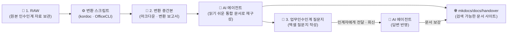

# 📋 인수인계 업무노트 (Handover Work Notes)

[](README.md)
[](https://www.python.org/)
[](https://nodejs.org/)
[](https://squidfunk.github.io/mkdocs-material/)
[](LICENSE)

> **전임자에게 받은 방대한 인수인계 자료(한글·엑셀·파워포인트·PDF 등)를 AI 코딩 에이전트가 자동 분석하고 마크다운(Markdown)으로 변환하여, 빠르고 체계적인 실시간 검색이 가능한 문서 사이트(MkDocs)로 구축해 주는 프로젝트입니다. 자료에서 부족한 부분은 전임자에게 보낼 엑셀 질문지로 정리하고, 회신받은 답변으로 문서를 보강합니다.**

---



### ✨ 핵심 특징

- 📖 **읽기 쉬운 통합 문서**: 원본을 그대로 옮기거나 요약하지 않고, 내용을 생략 없이 업무 단위로 재구성하여 인수인계 건마다 하나의 문서로 만듭니다. 절차는 다이어그램, 일정과 연락처는 표, 수치는 차트로 정리합니다.
- 📁 **국내 공공·기업 문서 완벽 지원**: 한글(`.hwp`, `.hwpx`), PDF(스캔본 자동 OCR 지원), 워드(`.docx`), 엑셀(`.xlsx`, `.xls`), 파워포인트(`.pptx`), 이미지(`.png`, `.jpg`) 등 다양한 포맷을 빠짐없이 마크다운으로 추출합니다.
- 🤖 **AI 코딩 에이전트 표준 준수**: [`AGENTS.md`](AGENTS.md) 및 [`CLAUDE.md`](CLAUDE.md) 지침을 탑재하여 Antigravity IDE, Claude Code, Cursor, Windsurf 등 다양한 AI 에이전트와 완벽히 연동됩니다.
- ⚡ **원클릭 자동 실행**: 최신 Python과 Git이 준비된 환경에서 관리자 권한(UAC/sudo) 없이 필요한 런타임을 자동 구성하며, 단 하나의 명령으로 즉시 사이트를 로컬에 구동합니다.
- 🔒 **로컬 보안 및 원본 무결성**: 모든 변환과 문서 사이트 서비스는 외부 전송 없이 로컬 PC 내부에서만 수행되며, 원본 문서는 오직 읽기 전용으로 안전하게 보호됩니다.
- 📝 **질문지 작성과 답변 반영**: 자료만으로 알 수 없는 절차·담당·일정·권한 등을 전임자에게 물어볼 엑셀 질문지로 정리하고, 답변이 돌아오면 해당 문서에 보충 답변으로 반영합니다.
- 🔄 **스마트 증분 갱신**: 신규 파일 추가 및 변경 사항만 감지하여 선별적으로 변환하므로 유지보수가 빠르고 효율적입니다.

---

## 📑 목차

- [폴더 구성](#폴더-구성)
- [지원 파일 형식](#지원-파일-형식)
- [1. 처음 설치하기 (설치 스크립트)](#1-처음-설치하기-설치-스크립트)
  - [1.1 프로젝트 다운로드](#11-프로젝트-다운로드)
  - [1.2 Windows 설치](#12-windows-설치)
  - [1.3 macOS 설치](#13-macos-설치)
  - [1.4 AI 코딩 에이전트 준비](#14-ai-코딩-에이전트-준비)
- [2. 수동 설치 가이드](#2-수동-설치-가이드)
  - [2.1 Windows (PowerShell)](#21-windows-powershell)
  - [2.2 macOS (터미널)](#22-macos-터미널)
- [3. 설치 확인](#3-설치-확인)
- [4. 사용 방법 (워크플로우)](#4-사용-방법-워크플로우)
  - [4.1 원본 자료 넣기](#41-원본-자료-넣기)
  - [4.2 AI 에이전트에게 일괄 작업 요청 (권장)](#42-ai-에이전트에게-일괄-작업-요청-권장)
  - [4.3 질문지를 인계자에게 전달하기](#43-질문지를-인계자에게-전달하기)
  - [4.4 회신받은 답변 반영하기](#44-회신받은-답변-반영하기)
  - [4.5 변환만 직접 실행하기 (CLI)](#45-변환만-직접-실행하기-cli)
  - [4.6 사이트 실행 및 열람](#46-사이트-실행-및-열람)
  - [4.7 AI 에이전트 조치 필요 단계 대응](#47-ai-에이전트-조치-필요-단계-대응)
  - [4.8 자료 추가 및 수정 반영](#48-자료-추가-및-수정-반영)
- [5. 문제 해결 (FAQ)](#5-문제-해결-faq)
- [6. 주의 사항 및 보안 가이드](#6-주의-사항-및-보안-가이드)
- [7. 다른 PC로 이전하기](#7-다른-pc로-이전하기)
- [8. 라이선스 및 크레딧](#8-라이선스-및-크레딧)

---

## 폴더 구성

| 경로 | 설명 |
| :--- | :--- |
| `1. RAW/` | 인수인계 자료 원본 폴더입니다. 받은 자료를 폴더째 그대로 넣는 곳입니다. (`.gitignore`로 버전 관리 제외) |
| `2. 변환 중간본/` | 변환 스크립트가 생성하는 파일별 마크다운, `manifest.json`(진행 기록), `변환 보고서.md` 저장 위치입니다. |
| `3. 업무인수인계 질문지/` | AI 에이전트가 만든 엑셀 질문지(`YYMMDD <인계자명> 업무인계인수 질문지.xlsx`)가 저장되는 곳이며, 인계자에게 회신받은 파일도 여기에 넣습니다. (`.gitignore`로 버전 관리 제외) |
| `mkdocs/docs/handover/` | AI 에이전트가 읽기 쉽게 재구성한 통합 문서(인수인계 건마다 하나)가 위치하며, 웹 사이트에 표시됩니다. 질문지 답변이 돌아오면 이 문서가 보강됩니다. |
| `mkdocs/mkdocs.yml` | 사이트 환경 설정, 테마, 플러그인 및 내비게이션 메뉴(`nav`) 정의 파일입니다. |
| `setup/` | Windows 및 macOS 환경을 위한 자동 설치 및 실행 스크립트(`setup-*`, `serve-*`) 모음입니다. |
| `LICENSES/` | 서드파티 소프트웨어(Material for MkDocs 등)의 라이선스 전문입니다. 사이트 빌드 시 자동 복사됩니다. |
| `.agents/skills/` | AI 코딩 에이전트가 변환·정리·다이어그램 시각화 시 수행하는 표준 작업 절차(스킬)입니다. |
| `AGENTS.md`, `CLAUDE.md` | AI 코딩 에이전트가 프로젝트를 이해하고 명령을 수행할 수 있도록 정의된 프로젝트 표준 지침입니다. |

---

## 지원 파일 형식

| 형식 | 처리 도구 | 설명 |
| :--- | :---: | :--- |
| 한글(`.hwp`, `.hwpx`) | [kordoc](https://github.com/chrisryugj/kordoc) | 표, 본문, 글상자 등 완벽 마크다운 변환 |
| PDF(`.pdf`) | [kordoc](https://github.com/chrisryugj/kordoc) | 텍스트 추출 및 스캔 문서 내장 OCR 자동 판독 |
| 워드(`.docx`), 엑셀(`.xlsx`, `.xls`) | [kordoc](https://github.com/chrisryugj/kordoc) | 서식 유지 마크다운 변환 및 시트별 표 정리 |
| 이미지(`.png`, `.jpg`, `.jpeg`) | [kordoc](https://github.com/chrisryugj/kordoc) | 이미지 내 텍스트 OCR 인식 |
| 파워포인트(`.pptx`) | [OfficeCLI](https://github.com/iOfficeAI/OfficeCLI) | 슬라이드별 본문 구조화 변환 |
| 텍스트(`.txt`, `.md`), CSV | 자체 스크립트 | UTF-8/CP949 자동 인코딩 감지 변환 |

> [!NOTE]
> `.doc`, `.ppt`와 같은 구형 바이너리 포맷이나 `.zip` 압축 파일은 직접 변환되지 않습니다. 구형 문서는 최신 형식(`.docx`, `.pptx`)으로 다른 이름으로 저장하고, 압축 파일은 압축을 해제하여 `1. RAW/` 폴더에 넣어주십시오.

---

## 1. 처음 설치하기 (설치 스크립트)

> [!IMPORTANT]
> **권장 사전 요구사항 (Prerequisites)**:  
> 본 프로젝트의 가장 안정적인 구동 및 스크립트 실행을 위해 **최신 버전의 Python (3.10 이상 권장, 3.12 권장)**과 **Git**이 시스템에 사전에 설치되어 있어야 합니다.
> - **Python 공식 다운로드**: [python.org/downloads](https://www.python.org/downloads/)  
>   *(Windows 설치 시 반드시 첫 화면 맨 아래의 **`Add python.exe to PATH`**를 체크하십시오.)*
> - **Git 공식 다운로드**: [git-scm.com/downloads](https://git-scm.com/downloads)
> 
> *참고: 미설치 상태이더라도 제공되는 설치 스크립트가 패키지 관리자(`winget`/`brew`)나 `uv`를 통해 자동 설치를 시도하지만, OS 환경이나 회사 PC 보안 정책에 따라 차단될 수 있으므로 사전에 공식 설치본으로 준비해 두시는 것을 강력히 권장합니다.*

설치 스크립트는 PC 환경을 감지하여 필요한 의존성(Node.js·kordoc·OfficeCLI·MkDocs 등) 중 **없는 것만 선별적으로 자동 설치**합니다.

- 이미 설치된 프로그램은 건너뛰므로 중복 실행해도 안전합니다.
- 인터넷 회선 속도에 따라 최초 1회 설치에는 약 5~15분이 소요됩니다.

### 📦 도구 구성 목록

| 프로그램 | 용도 및 권장 상태 | 버전 |
| :--- | :--- | :---: |
| **Git** | 형상 관리 및 스크립트 실행 (**사전 설치 권장**) | 최신 |
| **Python** | 문서 사이트(MkDocs) 및 변환 스크립트 구동 (**최신 버전 사전 설치 권장**, 미설치 시 [uv](https://docs.astral.sh/uv/)로 자동 구성) | 3.10 이상 (3.12 권장) |
| **Node.js** | kordoc 및 다이어그램 도구 런타임 | 20 이상 (LTS) |
| **kordoc** | 한글·PDF·워드·엑셀·이미지 일괄 변환 도구 | 최신 |
| **OfficeCLI** | 파워포인트 슬라이드 구조 추출 도구 | 최신 |
| **MkDocs & Material** | 검색 및 반응형 UI를 제공하는 문서 사이트 프레임워크 (`.venv`에 격리 설치) | requirements.txt 기준 |
| **Pretty Mermaid** | Mermaid 다이어그램 사전 시각화 도구 (`.agents/skills/pretty-mermaid`) | 최신 |
| **Homebrew** | macOS 패키지 관리자 (macOS 한정) | 최신 |

---

### 1.1 프로젝트 다운로드

최신 **Git**이 설치되어 있다면 터미널에서 클론하는 것을 가장 권장합니다:

```bash
git clone <저장소-URL>
cd <저장소-폴더명>
```

Git 없이 압축 파일로 받는 경우:
1. GitHub 저장소 우측 상단의 **`Code` → `Download ZIP`**을 클릭하여 다운로드합니다.
2. 경로가 너무 길지 않은 위치에 압축을 해제합니다.
   - **Windows 권장**: `C:\work\handover` 또는 드라이브 루트에 가까운 짧은 경로
   - **macOS 권장**: `~/Documents/handover` 등
3. **Windows 사용자 필수 확인**:
   - 다운로드한 ZIP 파일을 압축 해제하기 전, 파일 우클릭 → **`속성`** → 하단의 **`차단 해제(Unblock)`**를 체크하고 `확인`을 누르면 보안 경고 없이 쾌적하게 실행할 수 있습니다.

---

### 1.2 Windows 설치

1. 파일 탐색기에서 프로젝트 내부의 `setup/` 폴더로 이동합니다.
2. **`setup-windows.cmd`** 파일을 더블클릭합니다.
3. 진행 중 나타나는 시스템 대화상자에 응답합니다:
   - `Windows의 PC 보호` (SmartScreen): **`추가 정보`** → **`실행`** 클릭
   - `사용자 계정 컨트롤(UAC)`: Git 및 Node.js 설치 승인 요청 시 **`예`** 클릭
4. 콘솔에 `설치가 끝났습니다.`가 출력되면 Enter 키를 눌러 창을 닫습니다.
5. **열려 있는 모든 터미널(PowerShell, VS Code 등)을 완전히 닫고 다시 실행**합니다. (환경 변수 PATH 갱신)

> [!TIP]
> **Windows 긴 경로(Long Path) 활성화 권장**:  
> 인수인계 자료는 폴더 층위가 깊고 파일명이 긴 경우가 많아 Windows의 기본 260자 경로 제한에 걸릴 수 있습니다. PowerShell을 **관리자 권한**으로 실행한 후 아래 명령을 실행하고 PC를 재부팅하는 것을 권장합니다:
> ```powershell
> New-ItemProperty -Path "HKLM:\SYSTEM\CurrentControlSet\Control\FileSystem" -Name "LongPathsEnabled" -Value 1 -PropertyType DWORD -Force
> ```

스크립트 수동 실행 (PowerShell):
```powershell
powershell -NoProfile -ExecutionPolicy Bypass -File setup\setup-windows.ps1
```

---

### 1.3 macOS 설치

1. `응용 프로그램` → `유틸리티` → **`터미널(Terminal)`**을 엽니다.
2. `cd ` 입력 후 프로젝트 폴더를 터미널로 드래그 앤 드롭한 뒤 Enter를 누릅니다.
3. 아래 설치 명령을 입력합니다:
   ```bash
   bash setup/setup-mac.sh
   ```
4. 진행 중 다음 요청이 나타나면 진행합니다:
   - `Password:` Mac 로그인 암호 입력 (입력 시 화면에 글자가 표시되지 않음)
   - `Xcode Command Line Tools` 설치 창이 나타나면 `설치` 클릭
5. 설치가 완료되면 **터미널을 종료하고 새로 실행**합니다.

---

### 1.4 AI 코딩 에이전트 준비

변환 산출물을 읽고 인수자가 이해하기 쉬운 통합 문서로 재구성하여 MkDocs 사이트에 등록하는 작업과, 질문지를 만들고 답변을 반영하는 작업은 **AI 코딩 에이전트**가 전담합니다.

본 프로젝트는 AI 에이전트 표준 지침서인 [`AGENTS.md`](AGENTS.md)와 [`CLAUDE.md`](CLAUDE.md)를 내장하고 있으므로, 아래와 같은 주요 에이전트 환경에서 즉시 구동됩니다:
- **Antigravity IDE**
- **Claude Code**
- **Cursor / Windsurf / VS Code (Cline, Roo Code 등)**

#### Claude Code 설치 예시
```powershell
# Windows (PowerShell)
irm https://claude.ai/install.ps1 | iex
```
```bash
# macOS (Terminal)
curl -fsSL https://claude.ai/install.sh | bash
```

설치 후 프로젝트 디렉토리에서 에이전트를 실행하고, 프롬프트에 `업무노트 실행해줘` 또는 `1. RAW 폴더의 자료를 모두 변환해서 사이트에 등록해줘`라고 지시하면 됩니다.

---

## 2. 수동 설치 가이드

네트워크 제한이나 사내 정책 등으로 자동 설치 스크립트가 중단된 경우, 아래 절차에 따라 개별 도구를 직접 설치할 수 있습니다.

### 2.1 Windows (PowerShell)

```powershell
# 1. 스크립트 실행 권한 부여
Set-ExecutionPolicy -Scope CurrentUser RemoteSigned

# 2. 필수 런타임 설치 (winget)
winget install -e --id Git.Git --accept-source-agreements --accept-package-agreements
winget install -e --id Python.Python.3.12 --accept-source-agreements --accept-package-agreements
winget install -e --id OpenJS.NodeJS.LTS --accept-source-agreements --accept-package-agreements

# (터미널 재실행 후 프로젝트 폴더에서 계속)

# 3. 문서 변환 CLI 도구 설치
npm install -g kordoc --allow-scripts=onnxruntime-node,protobufjs
irm https://raw.githubusercontent.com/iOfficeAI/OfficeCLI/main/install.ps1 | iex
git config --global core.longpaths true

# 4. 가상환경 구성 및 MkDocs 패키지 설치
py -m venv .venv
.venv\Scripts\python -m pip install -r mkdocs\requirements.txt

# 5. 다이어그램 도구 의존성 (선택)
cd .agents\skills\pretty-mermaid; npm install; cd ..\..\..
```

### 2.2 macOS (터미널)

```bash
# 1. Homebrew 설치 (미설치 시)
/bin/bash -c "$(curl -fsSL https://raw.githubusercontent.com/Homebrew/install/HEAD/install.sh)"

# 2. 필수 도구 설치
brew install git python node

# 3. 문서 변환 CLI 도구 설치
npm install -g kordoc --allow-scripts=onnxruntime-node,protobufjs
curl -fsSL https://raw.githubusercontent.com/iOfficeAI/OfficeCLI/main/install.sh | bash

# (터미널 재실행 후 프로젝트 폴더에서 계속)

# 4. 가상환경 구성 및 MkDocs 패키지 설치
python3 -m venv .venv
.venv/bin/pip install -r mkdocs/requirements.txt

# 5. 다이어그램 도구 의존성 (선택)
(cd .agents/skills/pretty-mermaid && npm install)
```

---

## 3. 설치 확인

모든 필수 도구가 올바르게 인식되는지 확인하려면 프로젝트 루트에서 아래 검증 명령을 실행합니다:

```powershell
# Windows
.venv\Scripts\python .agents\skills\handover-to-mkdocs\scripts\convert.py --check
```
```bash
# macOS
.venv/bin/python .agents/skills/handover-to-mkdocs/scripts/convert.py --check
```

**정상 출력 예시:**
```text
python           3.12.x (또는 3.10+)
mkdocs           1.6.1
mkdocs-material  9.x.x
node             v20.x.x (또는 이상)
kordoc           4.x.x
officecli        1.x.x
```
6개 항목 모두 버전 번호가 정상적으로 출력되면 모든 준비가 완료된 것입니다.

---

## 4. 사용 방법 (워크플로우)

### 4.1 원본 자료 넣기

전임자나 인수인계자에게 받은 모든 문서와 폴더를 **`1. RAW/`** 디렉토리에 그대로 복사합니다.
- 하위 폴더 계층이 복잡하거나 파일 수가 수백 개에 달해도 그대로 유지하면 됩니다.
- 암호가 걸린 문서는 미리 암호를 해제하여 저장해 주십시오.

---

### 4.2 AI 에이전트에게 일괄 작업 요청 (권장)

프로젝트 폴더에서 AI 에이전트(예: Antigravity IDE, Claude Code 등)를 실행하고 다음 명령을 요청합니다:

```text
1. RAW 폴더의 자료를 모두 변환해서 사이트에 등록해줘.
```

AI 에이전트는 [`.agents/skills/handover-to-mkdocs/SKILL.md`](.agents/skills/handover-to-mkdocs/SKILL.md) 지침에 따라 아래 작업을 자율적으로 수행합니다:
1. 환경 진단 및 필수 도구 가용성 검증
2. 일괄 변환 스크립트 실행 및 결과 보고서 분석
3. 변환된 자료를 모두 읽고 업무 단위로 장 구성 설계
4. 내용을 생략하지 않고 표·다이어그램·차트로 재구성한 통합 문서(인수인계 건마다 md 하나) 작성 및 `mkdocs.yml` 메뉴 등록
5. 원본 파일 대응표 및 추적 메타데이터 갱신
6. `mkdocs build --strict` 유효성 검증
7. 자료만으로 알 수 없는 사항을 뽑아 `3. 업무인수인계 질문지/`에 엑셀 질문지 생성

---

### 4.3 질문지를 인계자에게 전달하기

등록이 끝나면 AI 에이전트가 [`.agents/skills/handover-questionnaire/SKILL.md`](.agents/skills/handover-questionnaire/SKILL.md) 지침에 따라 **`3. 업무인수인계 질문지/`** 폴더에 질문지를 만듭니다. 파일명은 `작성일(YYMMDD) 인계자명 업무인계인수 질문지.xlsx` 형식입니다(예: `261012 조호재 업무인계인수 질문지.xlsx`).

| 시트 | 내용 |
| :--- | :--- |
| `안내` | 인계자, 작성일, 질문 수, 작성 방법 |
| `질문지` | 번호, 업무 분야, 관련 자료, 관련 내용, 질문, 질문 유형, 중요도, **답변**, **참고 자료·비고**, 반영 문서 |

1. 엑셀 파일을 열어 질문을 검토합니다. 필요 없는 질문은 행을 지우고, 직접 묻고 싶은 내용은 표 맨 아래에 행을 추가하여 `질문` 칸에 적습니다.
2. 파일을 인계자에게 전달합니다. 인계자는 노란색 칸(`답변`, `참고 자료·비고`)만 작성하면 됩니다.
3. `번호`와 `반영 문서` 칸은 답변을 문서에 반영할 때 사용하는 값이므로 수정하지 않습니다.

질문지만 따로 만들고 싶을 때는 에이전트에게 다음과 같이 요청합니다:

```text
인계자에게 보낼 질문지 만들어줘.
```

---

### 4.4 회신받은 답변 반영하기

1. 인계자가 답변을 적어 보낸 엑셀 파일을 **`3. 업무인수인계 질문지/`** 폴더에 넣습니다. 원래 파일을 덮어써도 되고, 다른 이름으로 넣어도 됩니다.
2. 인계자가 추가 자료를 함께 보냈다면 `1. RAW/`의 해당 인수인계 폴더에 넣습니다.
3. 에이전트에게 다음을 요청합니다:
   ```text
   질문지 답변 왔어. 문서에 반영해줘.
   ```
4. 에이전트는 답변의 내용으로 통합 문서의 해당 절(비어 있던 절차, 담당, 일정 등)을 채우고 출처(`질문지 261012 · Q-001`)를 표시합니다. 질문과 답변의 원문은 문서의 `인계자 보충 답변` 섹션에 그대로 남습니다.
5. 답변이 비어 있는 질문은 `미회신`으로 문서에 남습니다. 나중에 나머지 답변을 받으면 같은 방법으로 다시 요청합니다.

---

### 4.5 변환만 직접 실행하기 (CLI)

AI 에이전트 없이 문서 변환 결과와 중간 보고서만 확인하고 싶은 경우 직접 실행할 수 있습니다:

```powershell
# Windows
.venv\Scripts\python .agents\skills\handover-to-mkdocs\scripts\convert.py --dry-run   # 대상 목록 및 처리 도구 확인
.venv\Scripts\python .agents\skills\handover-to-mkdocs\scripts\convert.py             # 실제 변환 수행
```
```bash
# macOS
.venv/bin/python .agents/skills/handover-to-mkdocs/scripts/convert.py --dry-run
.venv/bin/python .agents/skills/handover-to-mkdocs/scripts/convert.py
```

변환이 완료되면 `2. 변환 중간본/` 디렉토리에 파일별 마크다운 파일과 상태 분석이 담긴 `변환 보고서.md`가 생성됩니다.

| CLI 옵션 | 기능 설명 |
| :--- | :--- |
| `--check` | 필수 도구 설치 상태만 점검 후 종료 |
| `--dry-run` | 실제 변환을 수행하지 않고 대상 파일 목록 및 처리 예정 도구만 출력 |
| `--force` | 이미 변환이 완료된 파일도 무시하고 전체 재변환 |
| `--ocr` | 모든 PDF 및 이미지에 OCR 강제 적용 |
| `--timeout 초` | 단일 파일 변환 제한 시간 설정 (기본: 600초) |

---

### 4.6 사이트 실행 및 열람

AI 에이전트에게 **`업무노트 실행해줘`**라고 지시하면, 가상환경이 없더라도 필요한 의존성을 백그라운드에서 자동 구성하고 로컬 개발 서버를 띄워 접속 주소를 안내합니다.

수동으로 실행하려면 프로젝트 폴더에서 아래 명령을 실행합니다:

```powershell
# Windows (반드시 PowerShell에서 실행)
powershell -NoProfile -ExecutionPolicy Bypass -File setup\serve-windows.ps1
```
```bash
# macOS
bash setup/serve-mac.sh
```

- 웹 브라우저에서 **<http://127.0.0.1:8000>** 접속
- 실시간 문서 검색 단축키: <kbd>S</kbd>, <kbd>/</kbd>, <kbd>F</kbd>
- 서버 종료: 터미널에서 <kbd>Ctrl</kbd> + <kbd>C</kbd>
- 이미 포트가 실행 중인 경우 중복 기동하지 않고 기존 접속 URL을 안내합니다.

---

### 4.7 AI 에이전트 조치 필요 단계 대응

스크립트 실행 중 사용자 계정 컨트롤(UAC) 승인, Mac 로그인 암호 입력 등 시스템 권한이 필요한 상황을 만나면 에이전트는 작업을 멈추고 `[사용자 조치 필요]` 메시지를 안내합니다.

1. 안내된 단계에 따라 수동 조치를 완료합니다.
2. AI 에이전트에게 **"했어"** 또는 **"완료"**라고 답변합니다.
3. 에이전트가 중단된 지점부터 자동으로 작업을 재개합니다.

---

### 4.8 자료 추가 및 수정 반영

새로운 인수인계 자료가 도착하거나 기존 문서가 변경되었을 때:
1. `1. RAW/` 폴더에 새 파일을 추가하거나 덮어씁니다.
2. 에이전트에게 다음을 요청합니다:
   ```text
   원본 폴더에 자료가 추가됐어. 사이트에 반영해줘.
   ```
3. 변환 시스템은 `manifest.json`을 기반으로 변경되지 않은 파일은 즉시 건너뛰고, 신규 및 변경된 파일만 선별 변환하여 사이트에 증분 반영합니다.

---

## 5. 문제 해결 (FAQ)

| 증상 및 오류 | 원인 및 해결 방법 |
| :--- | :--- |
| `setup-windows.cmd` 더블클릭 시 창이 바로 닫힘 | PowerShell을 열고 `powershell -NoProfile -ExecutionPolicy Bypass -File setup\setup-windows.ps1` 명령으로 직접 실행하여 에러 메시지를 확인합니다. |
| `winget을 찾을 수 없습니다` | Windows 기본 패키지 관리자가 구버전이거나 없는 상태입니다. Microsoft Store에서 **`앱 설치 관리자(App Installer)`**를 업데이트하거나, [2.1절 수동 설치](#21-windows-powershell) 안내를 따릅니다. |
| 사내 PC 관리자 권한(UAC) 제약 | Git과 Node.js만 사내 IT 부서에 1회 설치 지원을 요청하십시오. 핵심 사이트 구동 런타임(Python, uv, MkDocs)은 사용자 영역에 권한 없이 자동 설치됩니다. |
| 명령어를 찾을 수 없음 (`py`, `node`, `npm` 등) | 환경 변수(PATH)가 갱신되지 않은 상태입니다. 열려 있는 모든 터미널 창을 닫고 다시 실행하십시오. |
| PowerShell 스크립트 실행 보안 오류 (`PSSecurityException`) | `Set-ExecutionPolicy -Scope CurrentUser RemoteSigned`를 실행하여 스크립트 실행 정책을 허용합니다. |
| kordoc 실행 시 `MODULE_NOT_FOUND` 발생 | 패키지 설치가 손상되었습니다. `npm uninstall -g kordoc` 실행 후 `npm install -g kordoc --allow-scripts=onnxruntime-node,protobufjs`로 재설치합니다. |
| kordoc 설치 시 `onnxruntime-node` 경고 발생 | npm 12+의 스크립트 차단 정책 때문입니다. 반드시 `--allow-scripts` 옵션을 명시하여 설치해야 OCR 엔진이 동작합니다. |
| macOS에서 `npm install -g` 시 `EACCES: permission denied` | 공식 `.pkg` 설치본 권한 문제입니다. `brew install node`로 Node.js를 Homebrew 기반으로 전환하는 것을 권장합니다. |
| macOS에서 `officecli` 확인되지 않은 개발자 경고 | 터미널에서 `xattr -d com.apple.quarantine ~/.local/bin/officecli` 명령을 실행하여 격리 속성을 해제합니다. |
| `--check` 검증 시 `officecli 없음` 지속 | 새 터미널을 실행해 보고, 여전히 인식되지 않으면 [OfficeCLI 공식 릴리스](https://github.com/iOfficeAI/OfficeCLI/releases)에서 OS용 바이너리를 내려받아 설치합니다. |
| 변환 보고서에 `ENCRYPTED`, `DRM_PROTECTED` 표시 | 사내 문서보안(DRM) 또는 암호화 파일입니다. 사내 권한 해제 절차를 거친 사본으로 교체한 뒤 재실행하십시오. |
| 변환 보고서에 `IMAGE_BASED_PDF` 표시 | 텍스트가 없는 스캔본 PDF입니다. 최초 OCR 수행 시 약 18MB의 인식 모델을 자동 다운로드하므로 네트워크 연결 상태를 확인하십시오. |
| Windows에서 파일 경로 길이 초과 오류 발생 | [1.2절의 긴 경로 허용 레지스트리 설정](#12-windows-설치)을 적용하거나 프로젝트 폴더를 드라이브 최상단(`C:\work`)으로 이동하십시오. |
| `Unrecognised theme name: 'material'` 발생 | 가상환경(`.venv`) 내 Material for MkDocs가 미설치된 상태입니다. `serve-windows.ps1` 또는 `serve-mac.sh`를 재실행하면 자동 복구됩니다. |
| 사이트 구동 시 `Address already in use` 발생 | 이미 8000 포트를 사용하는 다른 프로세스가 있습니다. 해당 프로세스를 종료하거나 다른 포트를 지정하십시오. |
| 폐쇄망(사내망) 환경 배포 | [kordoc 오프라인 가이드](https://github.com/chrisryugj/kordoc/blob/main/docs/offline-deployment.md) 및 OfficeCLI 단독 실행 파일을 사내 저장소로 반입하여 활용합니다. |

---

## 6. 주의 사항 및 보안 가이드

- 🛡️ **원본 데이터 보존**:
  변환 스크립트와 AI 에이전트는 `1. RAW/` 폴더 내 원본 파일에 대해 **절대 수정·이동·삭제하지 않으며 순수 읽기(Read-Only)** 작업만 수행합니다.
- 💻 **100% 로컬 프로세싱**:
  문서 파싱, OCR 처리, 마크다운 변환 및 MkDocs 웹 서빙 등 모든 처리 엔진이 사용자의 로컬 머신에서 구동됩니다.
- 🚨 **저장소 공개 및 보안 주의 (중요)**:
  - 본 저장소는 범용 인수인계 사이트 템플릿(Starter Kit)으로 공개 제공됩니다.
  - 원본 폴더(`1. RAW/`), 중간 산출물(`2. 변환 중간본/`), 질문지 폴더(`3. 업무인수인계 질문지/`)는 `.gitignore`에 의해 버전 관리에서 엄격히 차단됩니다.
  - 하지만 AI 에이전트가 변환·정리하여 등록한 최종 문서(`mkdocs/docs/handover/`)에는 **실제 업무 내용, 사내 담당자 연락처, 내부 시스템 접근 방식 등 민감한 개인정보나 업무 기밀이 직접 포함**됩니다.
  - 따라서 **실제 인수인계 문서를 구축한 이후에는 본 프로젝트 저장소를 공개(Public) GitHub 저장소에 푸시하지 마십시오.** (개인 계정의 Private 저장소 또는 사내 내부 Git 저장소를 필히 사용하십시오.)

---

## 7. 다른 PC로 이전하기

인수인계 프로젝트 폴더를 후임자나 다른 PC로 안전하게 전달하는 방법입니다.

### 7.1 제외해야 하는 파일 (자동 재생성 대상 및 보안 데이터)

전달용 압축 파일을 만들 때는 아래 항목들을 제외해야 파일 용량이 가볍고 플랫폼 간 충돌이 발생하지 않습니다:
- `.venv/` (운영체제 종속적인 파이썬 가상환경)
- `.agents/skills/pretty-mermaid/node_modules/` (노드 모듈)
- `mkdocs/site/` (빌드 임시 폴더)
- `2. 변환 중간본/` (언제든 재생성 가능한 중간 결과물)
- `3. 업무인수인계 질문지/` (인계자와 주고받은 질문지. 전달받는 사람에게 필요한 경우에만 따로 전달)

### 7.2 Git을 활용한 클린 압축 (가장 권장)

모든 변경 사항을 커밋한 후 아래 명령을 실행하면 `.gitignore`에 등록된 불필요한 환경 파일들을 자동으로 제외하고 깨끗한 릴리스 압축 파일을 생성합니다:

```bash
git archive --format=zip -o 업무노트_전달본.zip HEAD
```

> [!WARNING]
> `mkdocs/docs/` 아래에 이미 정리된 인수인계 문서가 포함되어 있다면 해당 내용에 전달받는 사람이 열람해서는 안 되는 기밀이 포함되어 있지 않은지 최종 확인하십시오.

### 7.3 전달받은 후 실행 단계

1. 전달받은 압축 파일을 원하는 위치에 압축 해제합니다.
2. PC에 최신 버전의 **Python (3.10 이상)** 및 **Git**이 사전에 설치되어 있는지 확인합니다.
3. AI 코딩 에이전트를 실행합니다.
4. 에이전트에게 **`업무노트 실행해줘`**라고 지시하면 즉시 로컬 웹 사이트가 복원되어 구동됩니다.

---

## 8. 라이선스 및 크레딧

- 본 템플릿 프로젝트는 [MIT License](LICENSE)를 따릅니다.
- **Material for MkDocs**: Martin Donath ([MIT License](LICENSES/mkdocs-material.txt))
- **kordoc**: Chris Ryu ([kordoc Repository](https://github.com/chrisryugj/kordoc))
- **OfficeCLI**: iOfficeAI ([OfficeCLI Repository](https://github.com/iOfficeAI/OfficeCLI))
- **Beautiful Mermaid**: [beautiful-mermaid](https://github.com/mermaid-js/mermaid)
